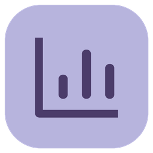
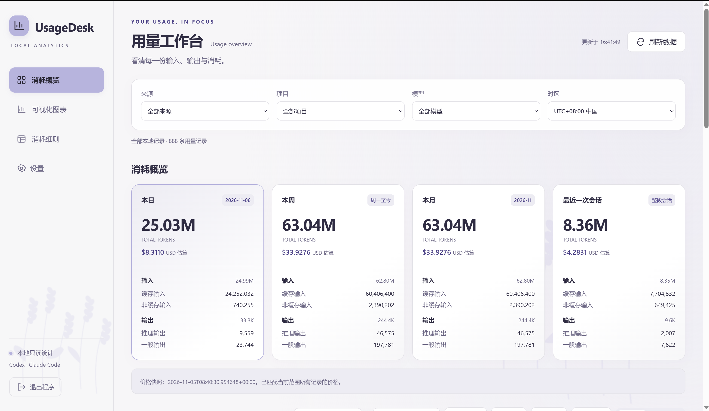
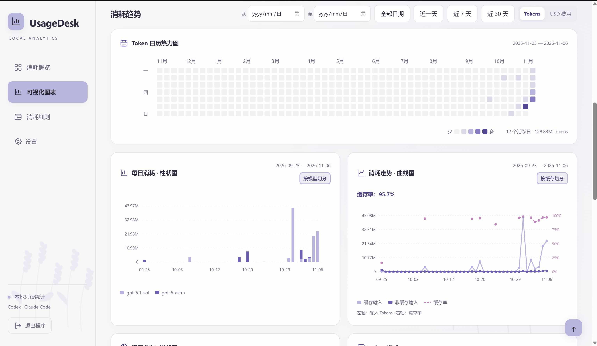
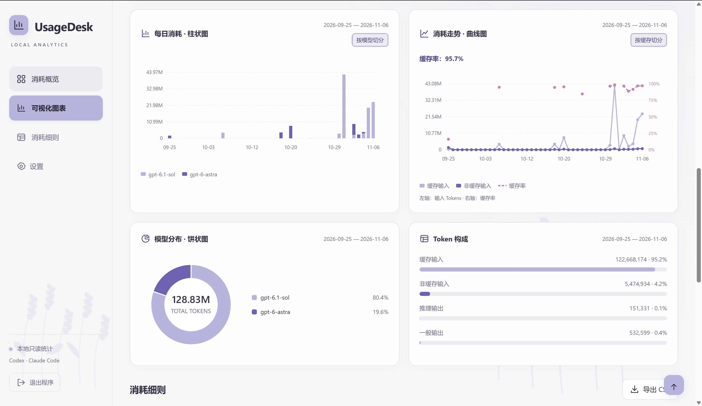
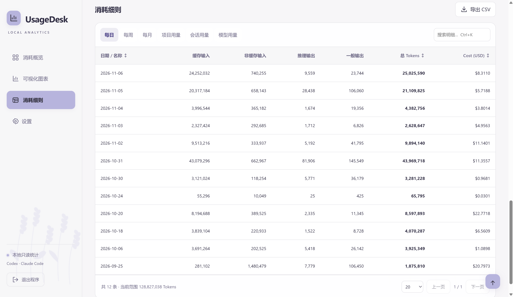
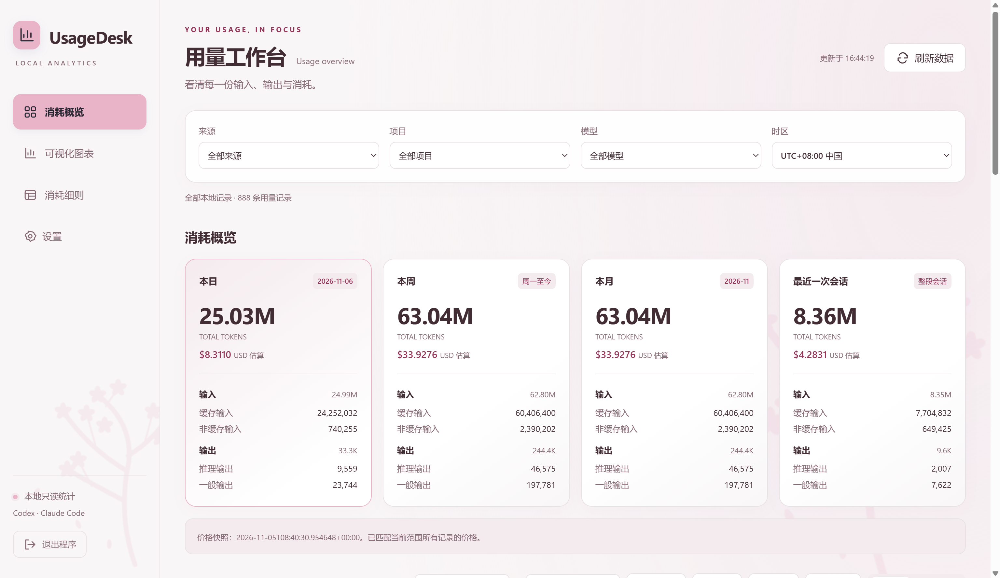
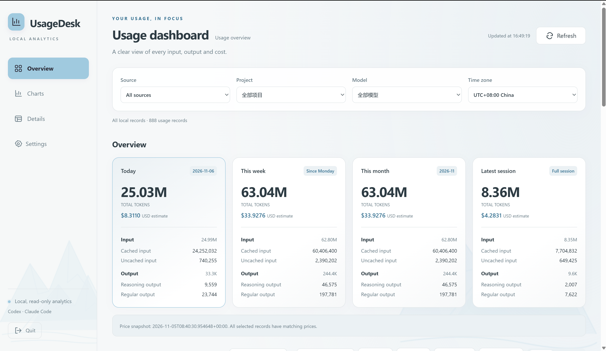
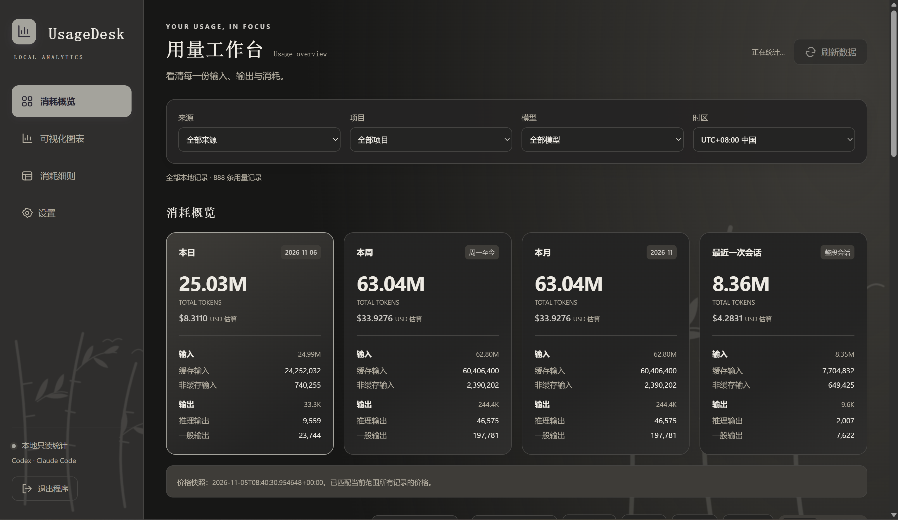
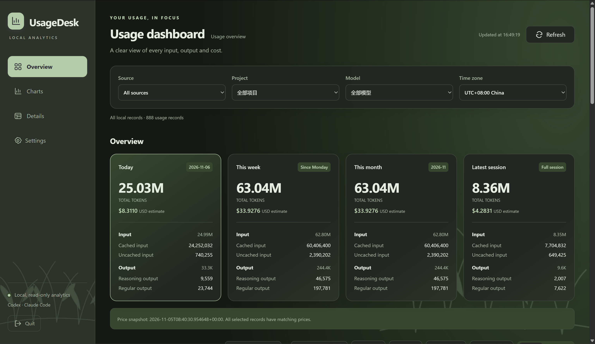

# UsageDesk 用量工作台

[中文](#zh-cn) · [English](#english)

<a id="zh-cn"></a>



**或许你想知道中转站的缓存与计费是否有误，亦或者你想了解订阅使用了多少tokens，来看看这个轻量插件吧！
我原意是自用以方便统计、满足视觉体验，也很开心拿出来分享。开发此插件使用了AI辅助，约消耗50MTokens。**

UsageDesk 是一个本地运行的多渠道用量统计工具，支持 Codex、Claude Code、Antigravity、Cursor、DSH 和 OpenCode，将 Token 消耗和估算费用整理成概览、明细和图表。

默认使用中文、浅色背景和薰衣草紫主题，可在设置中切换语言、背景和风格。提供 Windows EXE 入口，也可以直接运行 Python 源码。

## 开始使用

仓库包含 [dist/UsageDesk.exe](dist/UsageDesk.exe)。下载仓库 ZIP 并解压，或克隆仓库后，双击这个文件即可打开。它无需安装 Python、Node。

也可以运行 Python 源码，相关命令集中放在下方“命令行使用”。

程序优先使用本机 Edge 或 Chrome 的独立应用窗口，没有找到时使用默认浏览器。点击侧栏“退出程序”即可关闭后台服务。直接关闭窗口后，后台服务约 3 分钟内退出。

## 功能

| 功能 | 内容 |
| --- | --- |
| 消耗概览 | 本日、本周、本月、最近一次会话 |
| Token 拆分 | 缓存输入、非缓存输入、推理输出、一般输出、总 Tokens |
| 费用估算 | Cost (USD)、离线价格快照、手动更新价格、自定义模型单价 |
| 消耗明细 | 按每日、每周、每月、项目、会话和模型查看 |
| 可视化 | Token 日历热力图、柱状图、趋势曲线图、模型饼状图 |
| 筛选与导出 | 来源、项目、模型、日期筛选；搜索、排序、分页和 CSV 导出 |
| 通用设置 | 中文 / English、浅色 / 深色背景、六种带朦胧装饰的主题 |

支持近 7 天 / 近 30 天快捷范围、筛选重置、键盘搜索和返回顶部。页面每 30 秒刷新一次，也可手动刷新。

## 界面截图

### UI 概览

| 消耗与用量 | 日历与趋势 |
| --- | --- |
|  |  |
| **模型与 Token 构成** | **消耗细则** |
|  |  |

### 主题与语言

| 樱花粉（浅色、中文） | 冰川蓝（浅色、英文） |
| --- | --- |
|  |  |
| **古风黑（深色、中文）** | **草原绿（深色、英文）** |
|  |  |

## 统计说明

总 Tokens = 输入 + 输出。缓存输入属于输入，推理输出属于输出。

默认使用 UTC+08:00，周一为一周的开始。最近一次会话指最后出现用量记录的整段会话。

日期范围影响图表和明细；概览始终显示本日、本周、本月及最近会话。

Claude 日志通常不提供推理拆分，因此部分输出会显示为“一般 / 未拆分输出”。

USD 是 API 单价估算，非实际费用。 无法匹配价格的记录显示“未定价”，可自行补充单价。

当前读取普通 `.jsonl`，压缩日志、缺失记录、复杂分叉历史及未记录的工具费用可能造成统计差异。

公开价格快照来自 LiteLLM，历史用量按当前快照估算。

## 设置

点击侧栏“设置”，可以切换“通用设置”和“数据与价格”两个页面。

通用设置的语言、背景和风格会立即生效并自动保存，重新打开程序后沿用。每种风格均可搭配浅色或深色背景，图表配色也会随主题变化。默认是中文、浅色背景、薰衣草紫。

| 风格 | 装饰图案 |
| --- | --- |
| 薰衣草紫 | 薰衣草与轻雾 |
| 古风黑 | 竹叶、飞鸟与淡墨轮廓 |
| 樱花粉 | 樱花树与飘落花瓣 |
| 枫叶红 | 落叶与简约凤凰线条 |
| 冰川蓝 | 冰川与薄雾 |
| 草原绿 | 青草与微风线条 |

默认读取 `%USERPROFILE%\.codex` 和 `%USERPROFILE%\.claude`，支持 `CODEX_HOME`、`CLAUDE_CONFIG_DIR` 环境变量。

使用其他目录时，在“设置 → 数据与价格”中填写根目录，每行一个，点击“保存并重新统计”。Codex 自动扫描 `sessions` 和 `archived_sessions`；Claude Code 自动扫描 `projects` 及其子目录。

Antigravity、Cursor、DSH 和 OpenCode 也可以在此设置路径，留空时自动查找。Cursor 支持用量 CSV、数据库文件或它们所在的目录，同时找到两类数据时优先读取 CSV。

个人设置保存在 `%LOCALAPPDATA%\UsageDesk`。原始会话日志只读。只有手动更新价格表时才下载公开价格数据。

## 命令行使用

在项目根目录打开 PowerShell，按用途选择下面的命令。运行源码只需要 Python 标准库；当前 Windows 构建使用 Python 3.14。

```powershell
# 打开仓库自带的 EXE，无需安装 Python；效果与双击相同
.\dist\UsageDesk.exe

# 运行源码：启动本机服务，并打开独立应用窗口
python app.py

# 启动网页服务；随后访问 http://127.0.0.1:8766
python app.py --server --port 8766

# 使用指定目录保存个人设置、价格缓存和浏览器数据
python app.py --state-dir "$HOME\UsageDeskData"

# 显示可用参数及说明
python app.py --help

# 安装生成 EXE 所需的依赖
python -m pip install -r requirements-build.txt

# 联网下载公开模型价格，更新项目内的 prices.json
python update_prices.py

# 将源码、网页、价格快照和许可证打包成 dist\UsageDesk.exe
.\build.ps1

# 计算 EXE 的 SHA-256 校验值，并写入校验文件；每次重新打包后更新
$exeHash = (Get-FileHash -Algorithm SHA256 .\dist\UsageDesk.exe).Hash
"$exeHash  UsageDesk.exe" | Set-Content -Encoding ascii .\dist\SHA256SUMS.txt
```

## 项目结构

| 路径 | 作用 |
| --- | --- |
| `app.py` | 程序入口、本机 HTTP API、配置保存与桌面窗口启动 |
| `engine.py` | 日志读取、去重、费用计算和统计汇总 |
| `extra_sources.py` | Antigravity、Cursor、DSH 和 OpenCode 的本地用量读取 |
| `web/index.html` | 页面结构与设置弹窗 |
| `web/style.css` | 主题、字体、图标尺寸与响应式布局 |
| `web/app.js` | 图表、筛选、搜索、导出与键盘交互 |
| `web/appearance.js` | 中英文界面、外观偏好、六种主题及 SVG 装饰 |
| `assets/` | 程序图标和界面截图 |
| `prices.json` | 可公开提交的离线价格快照 |
| `update_prices.py` | 下载并更新公开价格快照 |
| `requirements-build.txt` | 打包依赖 |
| `build.ps1` | Windows 打包脚本 |
| `dist/UsageDesk.exe` | 随仓库提交的 Windows 可执行程序 |
| `dist/SHA256SUMS.txt` | 随仓库提交的 EXE 校验值 |
| `licenses/` | 第三方许可证原文 |
| `THIRD_PARTY_NOTICES.md` | 参考项目、数据来源及第三方许可说明 |

## 参考与第三方许可

实现参考了[ccusage](https://github.com/ccusage/ccusage) 的源码、日志处理与统计思路；价格数据来自 [LiteLLM](https://github.com/BerriAI/litellm)。

参考提交、实现边界及许可证见 [THIRD_PARTY_NOTICES.md](THIRD_PARTY_NOTICES.md) 和 [licenses](licenses/)。

---

<a id="english"></a>

# UsageDesk — Local Usage Dashboard

[中文](#zh-cn) · [English](#english)


**Maybe you're wondering if there are discrepancies in the relay's cache and billing, or you want to check how many tokens your subscription has consumed — take a look at this lightweight plugin!
I originally built it for my own use, for easy statistics and a pleasant visual experience, and I’m happy to share it. This plugin was developed with AI assistance, consuming approximately 50M tokens.**

UsageDesk is a local usage dashboard for Codex, Claude Code, Antigravity, Cursor, DSH and OpenCode. It presents token usage and estimated costs through summaries, detailed reports and charts.

The defaults are Chinese, a light background and the Lavender theme. You can change the language, background and theme in Settings. A Windows executable is included, and you can also run the Python source.

## Getting started

The repository includes [dist/UsageDesk.exe](dist/UsageDesk.exe). Download and extract the repository ZIP, or clone the repository, then double-click the executable. Python and Node are not required.

You can also run the Python source. All commands are grouped in the “Command-line usage” section below.

The app uses a standalone Edge or Chrome window when available, falling back to your default browser. Select “Quit” in the sidebar to stop the background service. If you close the window directly, the service stops within approximately three minutes.

## Features

| Feature | Details |
| --- | --- |
| Usage overview | Today, this week, this month and the latest session |
| Token breakdown | Cached input, uncached input, reasoning output, regular output and total tokens |
| Cost estimates | Cost in USD, an offline price snapshot, manual price updates and custom model prices |
| Detailed reports | Daily, weekly, monthly, project, session and model usage |
| Charts | Token activity calendar, bar chart, trend line and model distribution pie chart |
| Filters and export | Filter by source, project, model and date; search, sort, paginate and export CSV |
| General settings | Chinese / English, light / dark backgrounds and six themes with subtle decorative artwork |

Includes last-7-day and last-30-day shortcuts, filter reset, keyboard search and a back-to-top button. Data refreshes every 30 seconds and can also be refreshed manually.

## Screenshots

### Interface overview

| Usage overview | Activity and trends |
| --- | --- |
|  |  |
| **Model and token breakdown** | **Usage details** |
|  |  |

### Themes and languages

| Cherry blossom(Light, Chinese) | Glacier blue(Light, English) |
| --- | --- |
|  |  |
| **Ink wash(Dark, Chinese)** | **Meadow green(Dark, English)** |
|  |  |

## How usage is calculated

Total tokens = input + output. Cached input is part of input, and reasoning output is part of output.

The default time zone is UTC+08:00, and weeks start on Monday. The latest session means the full session with the most recent usage record.

Date filters apply to charts and detailed reports. The overview continues to show today, this week, this month and the latest session.

Claude logs generally do not provide a reasoning breakdown, so some output is shown as “Regular / unsplit output.”

USD amounts are estimates based on API prices, not actual charges. Records without matching prices are marked “Unpriced”; you can add custom prices.

The app currently reads plain `.jsonl` files. Compressed logs, missing records, complex fork histories and unrecorded tool charges may cause differences in the totals.

The public price snapshot comes from LiteLLM. Historical usage is estimated using the current snapshot.

## Settings

Select “Settings” in the sidebar to switch between “General” and “Data & pricing.”

Language, background and theme changes take effect immediately, save automatically and persist when you reopen the app. Each theme supports both light and dark backgrounds, and chart colors follow the selected theme. The defaults are Chinese, light background and Lavender.

| Theme | Decorative artwork |
| --- | --- |
| Lavender | Lavender stems and soft mist |
| Ink wash | Bamboo leaves, birds and subtle ink outlines |
| Cherry blossom | A cherry tree and falling petals |
| Maple red | Falling leaves and a simple phoenix outline |
| Glacier blue | Glaciers and light mist |
| Meadow green | Grass and gentle breeze lines |

The default data directories are `%USERPROFILE%\.codex` and `%USERPROFILE%\.claude`. The `CODEX_HOME` and `CLAUDE_CONFIG_DIR` environment variables are also supported.

To use other directories, enter one home directory per line under “Settings → Data & pricing,” then select “Save & recalculate.” Codex scans `sessions` and `archived_sessions`; Claude Code scans `projects` and its subdirectories.

Paths for Antigravity, Cursor, DSH and OpenCode can be configured on the same page. Leave them blank for automatic discovery. Cursor accepts usage CSVs, database files or their containing directories and uses CSVs when both types are found.

Personal settings are stored in `%LOCALAPPDATA%\UsageDesk`. Original session logs are read-only. Public pricing data is downloaded only when you manually request a price update.

## Command-line usage

Open PowerShell in the project root and choose the commands you need. Running the source requires only the Python standard library. The current Windows build uses Python 3.14.

```powershell
# Launch the included EXE without Python; equivalent to double-clicking it
.\dist\UsageDesk.exe

# Run the source: start the local service and open an application window
python app.py

# Start the web service, then visit http://127.0.0.1:8766
python app.py --server --port 8766

# Store personal settings, cached prices and browser data in a chosen directory
python app.py --state-dir "$HOME\UsageDeskData"

# Show available options
python app.py --help

# Install the dependencies needed to build the EXE
python -m pip install -r requirements-build.txt

# Download public model prices and update the project's prices.json
python update_prices.py

# Bundle the source, web assets, price snapshot and licenses into dist\UsageDesk.exe
.\build.ps1

# Calculate and save the EXE's SHA-256 checksum; update it after every rebuild
$exeHash = (Get-FileHash -Algorithm SHA256 .\dist\UsageDesk.exe).Hash
"$exeHash  UsageDesk.exe" | Set-Content -Encoding ascii .\dist\SHA256SUMS.txt
```

## Project structure

| Path | Purpose |
| --- | --- |
| `app.py` | Application entry point, local HTTP API, settings persistence and desktop window launch |
| `engine.py` | Log parsing, deduplication, cost calculation and usage aggregation |
| `extra_sources.py` | Local usage adapters for Antigravity, Cursor, DSH and OpenCode |
| `web/index.html` | Page structure and settings dialog |
| `web/style.css` | Themes, typography, icon sizing and responsive layout |
| `web/app.js` | Charts, filters, search, export and keyboard interactions |
| `web/appearance.js` | Chinese / English interface, appearance preferences, six themes and SVG artwork |
| `assets/` | Application icons and screenshots |
| `prices.json` | Public offline price snapshot suitable for version control |
| `update_prices.py` | Downloads and updates the public price snapshot |
| `requirements-build.txt` | Build dependencies |
| `build.ps1` | Windows build script |
| `dist/UsageDesk.exe` | Windows executable included in the repository |
| `dist/SHA256SUMS.txt` | Checksum for the included executable |
| `licenses/` | Original third-party license texts |
| `THIRD_PARTY_NOTICES.md` | Reference projects, data sources and third-party license information |

## References and third-party licenses

The implementation draws on [ccusage](https://github.com/ccusage/ccusage), including its source code, log processing and usage reporting approaches. Pricing data comes from [LiteLLM](https://github.com/BerriAI/litellm).

For reference commits, implementation boundaries and licenses, see [THIRD_PARTY_NOTICES.md](THIRD_PARTY_NOTICES.md) and [licenses](licenses/).
